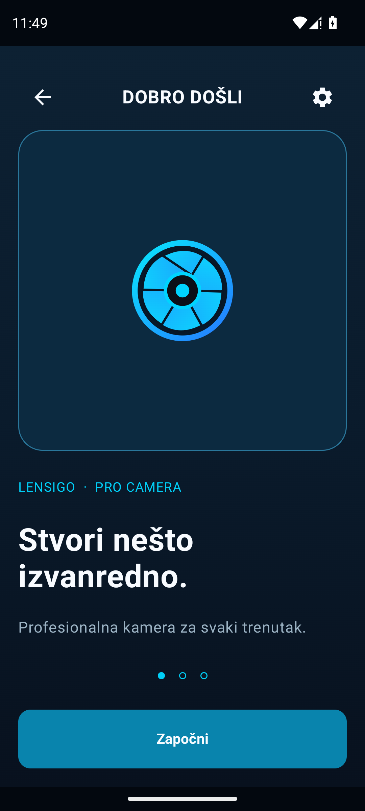
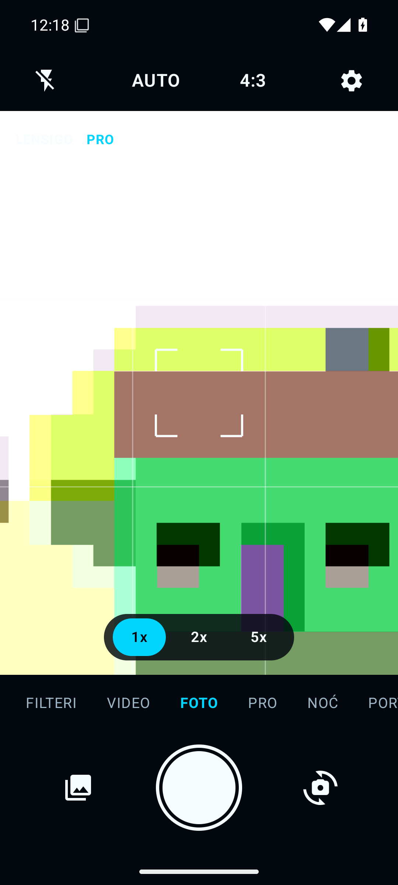
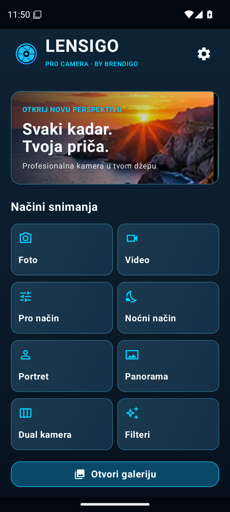
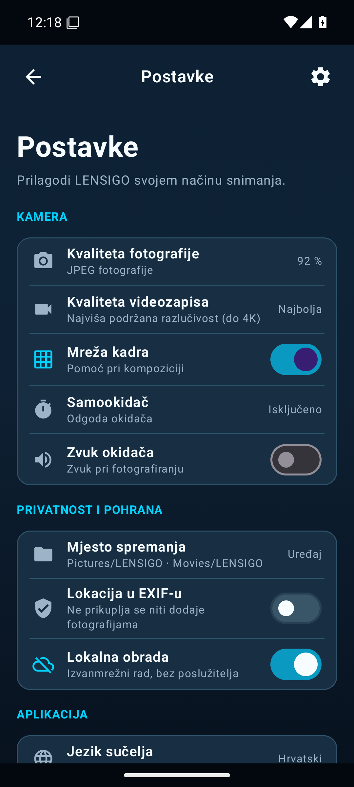
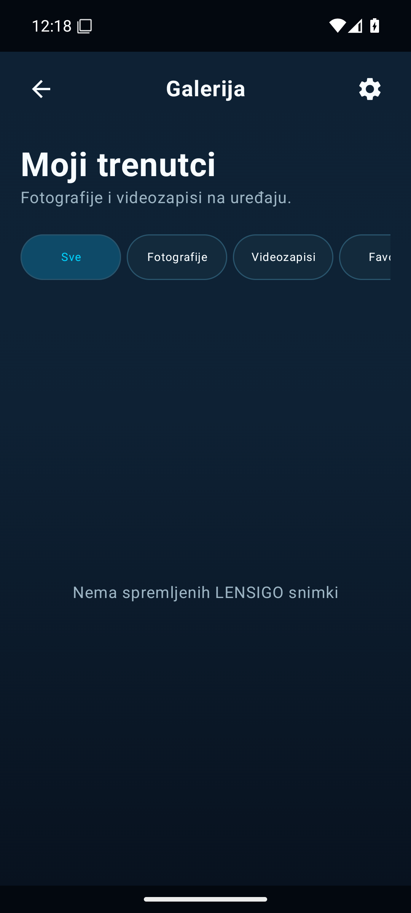

<p align="center"></p>

<h1 align="center">LENSIGO · PRO CAMERA</h1>
<p align="center"><strong>Svaki kadar. Tvoja priča.</strong><br><em>Every frame. Your story.</em></p>
<p align="center"><a href="https://brendigo.com"><strong>BRENDIGO</strong></a> · Profesionalnije fotografiranje na Androidu</p>
<p align="center">
  <a href="https://github.com/bren-wp/Lensigo-PRO/releases"></a>
  
  
  
</p>

## 📸 Tvoja kamera. Tvoja kontrola.

**LENSIGO** je Android kamera osmišljena za brzo snimanje, intuitivne ručne kontrole i obradu fotografija na samom uređaju. Tamno sučelje s cijan naglascima zadržava fokus na kadru. Aplikacija ne zahtijeva račun, nema reklama i ne koristi internetsku dozvolu.

### 🚀 Od dobrodošlice ravno do fotografiranja

**Uklonjen je zaseban zaslon „Dopuštenja”.** Nakon prvog pozdrava odmah se otvara kamera. Androidov vlastiti sigurnosni dijalog za pristup kameri pojavljuje se samo kada je potreban. Za zvuk videa mikrofon je izboran; na Androidu 7–9 dopuštenje spremanja traži se tek pri snimanju. Nema dodatnog međukoraka niti suvišnih aplikacijskih kartica.

### ✨ Osam načina snimanja

| Način | Što možeš raditi |
|---|---|
| 📷 **FOTO** | Fokusiraj dodirom, koristi bljeskalicu, zum, samookidač i kadar 4:3/16:9 |
| 🎬 **VIDEO** | Snimaj video uz dostupnu razlučivost uređaja i opcionalan zvuk |
| 🎛️ **PRO** | Ručno upravljaj podržanim ISO, ekspozicijom, fokusom i balansom bijele |
| 🌙 **NOĆ** | Koristi OEM noćni način ili lokalno poboljšanje kadra |
| 👤 **PORTRET** | Istakni osobu uz dostupnu Bokeh podršku ili lokalnu segmentaciju |
| 🏞️ **PANORAMA** | Fotografiraj nekoliko uzastopnih kadrova i spoji ih lokalno |
| 📱 **DUAL** | Kombiniraj stražnju i prednju kameru uz provjeru podrške uređaja |
| 🎨 **FILTERI** | Primijeni 12 lokalnih efekata s podesivim intenzitetom |

> RAW/DNG, HDR, 4K, 60 FPS, paralelne kamere i ručne kontrole nisu univerzalne značajke. LENSIGO ih nudi samo kada ih podržava aktivni senzor, CameraX i Android uređaj. Dual video nije implementiran.

### 🖼️ Uredi kadar — zadrži original

Galerija, pregled fotografija i videa, favoriti, izrezivanje, rotacija, kontrast, svjetlina i filteri dostupni su bez slanja medija u oblak. Uređena fotografija sprema se kao **nova kopija**, a original ostaje netaknut.

## 📱 Stvarni zasloni aplikacije — originalne Android snimke

Ovdje se objavljuju **isključivo izvorne PNG snimke pokrenute Android aplikacije**. Nikad ne zamjenjujemo screenshot dizajnerskim mockupom. Automatizirani emulator može snimiti zaslone koji ne zahtijevaju fizički senzor; njegovi kadrovi označeni su kao *emulator*, a ne fotografije s telefona.

<!-- BEGIN REAL LENSIGO SCREENSHOTS -->
**Stvarne snimke pokrenute aplikacije** — Android 15 emulator, 1080 × 2400 px, gustoća 480 dpi; stvarna kamera na fizičkom uređaju nije ovdje verificirana. Snimke nisu dizajnerski mockupovi.

<p align="center">





</p>

Izvor: `adb exec-out screencap -p`, GitHub Actions run `43125568367`. [Matrica za 1:1 mjerenje](docs/UI-ACCEPTANCE-MATRIX.md).
<!-- END REAL LENSIGO SCREENSHOTS -->

Pixel-perfect dokaz traži usporedbu **17 aktivnih zaslona za mobitel + 17 za tablet** pri jednakom viewportu, gustoći i skali fonta. Trenutno nema potvrde o 0% odstupanja. [Matrica vizualnih provjera](docs/UI-ACCEPTANCE-MATRIX.md).

### Više stvarnih prikaza, bez konceptnih slika

Automatizirano snimanje sada pokušava zabilježiti dodatne funkcionalne načine rada — Video, Pro, Noć, Portret, Panorama, Dual i Filteri — te prikaz O aplikaciji i Postavke kamere. Samo uspješno provjerene snimke pokrenutog APK-a ulaze u gornju galeriju. Hardverski nedostupni prikazi ne predstavljaju se kao testirani.

## 🎨 Prepoznatljiv LENSIGO identitet

<p align="center"></p>

Graphite `#081827` · Midnight `#10364C` · Cyan `#00D4FF` · Blue `#2E83FF` · White `#F5FAFF`.

Originalni LENSIGO znak koristi prilagodljivu Android launcher ikonu, tamnu splash pozadinu i monochrome sloj. Različite maske i rubove na proizvođačkim launcherima treba pregledati na stvarnim uređajima.

## 🔒 Privatnost i sigurnost

Fotografije i videozapisi ostaju na uređaju. Android manifest nema mrežne ni lokacijske dozvole, nema oglasnog SDK-a ni telemetrije. Mikrofon je izboran, a sustavske dozvole se traže prema potrebi. Zasebni zaslon Privatnost namjerno je uklonjen; stvarne zaštite ostaju. [Sigurnosna analiza](docs/FULL-UI-DEAD-CODE-SECURITY-AUDIT-2026-11-09.md).

## ⬇️ Preuzimanje

**[Najnovije izdanje — APK, AAB i SHA-256](https://github.com/bren-wp/Lensigo-PRO/releases/latest)**

- `app-debug.apk` — **testni APK** s debug potpisom, za ručnu instalaciju.
- `app-release.aab` — **nepotpisani** preview bundle; nije spreman za izravnu objavu na Google Playu.
- `SHA256SUMS.txt` — SHA-256 kontrolni zbrojevi za provjeru integriteta preuzetih datoteka.

Za produkciju treba vlastiti zaštićeni upload key, potpisane pakete, test nadogradnje i provjera Google Play pravilnika. Android 7.0+ (`minSdk=24`); projekt cilja Android API 36.

## 🧰 Za razvoj i doprinos

Projekt koristi **Kotlin · Jetpack Compose · CameraX · Camera2 · MediaStore**. Za izgradnju su potrebni Java 17, Android SDK, Gradle i Python (generiranje odobrenog rastera launcher ikone).

```bash
python -m pip install Pillow==12.3.0 numpy==2.3.5 CairoSVG==2.8.2
gradle :app:assembleDebug :app:testDebugUnitTest :app:lintDebug
gradle :app:bundleRelease
```

Kontrole kvalitete obuhvaćaju JVM testove, lint, sigurnosne invarijante, validaciju paketa i provjeru 16 KiB kompatibilnosti native biblioteka. **Stvarni foto/video testovi, baterija, RAM i 1:1 screenshot mjerenja zahtijevaju uređaje.**

[📋 Matrica uređaja](docs/DEVICE-TEST-MATRIX.md) · [🔍 Pixel audit](docs/PIXEL-AUDIT.md) · [📦 Objavljivanje izdanja](docs/RELEASE-PUBLISHING.md) · [🛡️ Google Play](docs/GOOGLE-PLAY-2026.md)

---

<p align="center"><strong>LENSIGO · PRO CAMERA</strong><br>© 2026 BRENDIGO · <a href="https://brendigo.com">brendigo.com</a><br><small>Projekt MIT; ovisnosti imaju zasebne licence.</small></p>

<!-- Galerija sadrži samo stvarne PNG snimke pokrenutog APK-a. Automatski se osvježava nakon uspješnog CI builda. -->
